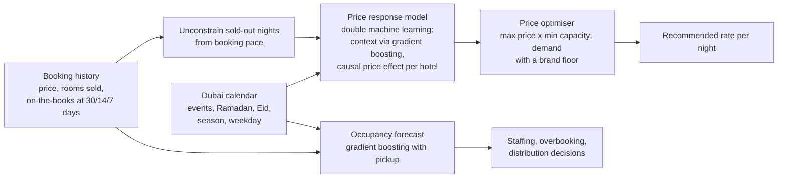

# 🏨 Dubai Hotel Revenue Management

**Forecast hotel demand around Dubai's events and seasons, learn how price-sensitive each hotel's guests
really are, and set a revenue-maximising price for every night.** The same approach applies to airline seats,
attraction tickets and event capacity.

> Data: a simulated Dubai market of 6 hotels (luxury resort, luxury city, business, midscale) over two years,
> with Dubai's real demand drivers: winter high season and summer low, New Year's Eve, Dubai Shopping Festival,
> GITEX, Gulfood, Arabian Travel Market, Dubai Airshow, Ramadan and Eid, and leisure vs business weekday patterns.
> Because the true demand curve is known, pricing policies can be compared fairly on the same demand. Figures are illustrative.

---

## Results (test period January to June 2026, 318,560 room-nights)

**Occupancy forecast, 14 days before arrival**

| Method | Error (MAPE) |
|---|---|
| **Gradient boosting (calendar + events + booking pace)** | **3.1%** |
| Additive pickup method (industry standard) | 5.6% |
| Same weekday last year | 10.9% |

**Dynamic pricing vs the hotels' rate card**

| | Rate card | Dynamic pricing |
|---|---|---|
| Revenue | AED 257.2M | **AED 269.4M** |
| Occupancy | 87.6% | 95.6% |
| ADR | AED 922 | AED 885 |
| RevPAR | AED 807 | **AED 846** |

**+4.8% revenue (AED 12.2M in six months)**, capturing 87% of the gain that would be possible with perfect knowledge
of demand. Every hotel improves, from +3.8% RevPAR (DIFC business hotel) to +7.4% (midscale Al Barsha), mostly by filling
rooms the rate card left empty in shoulder periods while still charging more on event nights.

**Why the method matters:** a naive model (price as just another feature, sold-out nights dropped) would have
**lost 12.5%** of revenue. It sees that prices were high when demand was high and concludes guests barely react to
price, so it over-prices. This project's price model recovers each hotel's true price elasticity within about 0.06.

| Hotel | Learned elasticity | True |
|---|---|---|
| Palm Beach Resort | -1.05 | -1.10 |
| Marina Luxury Hotel | -1.21 | -1.25 |
| Downtown Business Hotel | -1.49 | -1.45 |
| DIFC Executive Suites | -1.24 | -1.30 |
| Deira Midscale Inn | -1.79 | -1.85 |
| Al Barsha City Hotel | -1.72 | -1.75 |

---

## How it works



| Component | Where |
|---|---|
| Dubai market simulator, events calendar, legacy rate card | `src/hotelrm/market.py` |
| Occupancy forecast, baselines, price response (double ML), optimiser | `src/hotelrm/models.py` |
| Backtest and counterfactual pricing comparison | `src/hotelrm/pipeline.py` |
| Revenue manager dashboard with what-if price simulator | `dashboard.py` |

## Quick start

```bash
git clone https://github.com/vineethasusan/dubai-hotel-revenue-management.git
cd dubai-hotel-revenue-management
python -m venv .venv && source .venv/bin/activate
make install
make pipeline     # -> outputs/report.md, hotel_results.csv, pricing_decisions.csv.gz
make dashboard    # http://localhost:8501
```

## Design decisions

- **Causal price effect, not correlation.** Hotels raise prices when demand is high, so price and demand move together
  in the data. Double machine learning removes what the calendar explains from both, then measures the price effect on what is left.
- **Unconstrain sold-out nights.** A sold-out night shows capacity, not demand. True demand is estimated from the
  30-day booking pace, a standard revenue-management technique, rather than dropping those nights (which biases elasticity).
- **Fair comparison.** Rate card and dynamic pricing are scored on the same simulated demand and noise, against an upper
  bound with perfect information.
- **Business guardrails.** Prices never fall below 60% of the reference rate, protecting the brand.
- **Forecast for operations, model for pricing.** The 14-day occupancy forecast uses booking pace for accuracy; the pricing
  model uses only what is known when prices are set.

## Roadmap

- Airline version: fare classes, overbooking and connecting traffic through DXB
- Competitor rate shopping as an input (compset pricing index)
- Length-of-stay and channel (direct vs OTA) optimisation
- Bayesian elasticity updates as new rate tests come in

## Author

**Vineetha Susan Alexander** · Senior Data Scientist & AI Consultant, Dubai
[LinkedIn](https://www.linkedin.com/in/vineetha-susan-alexander-465997135) · [GitHub](https://github.com/vineethasusan)

MIT License.
